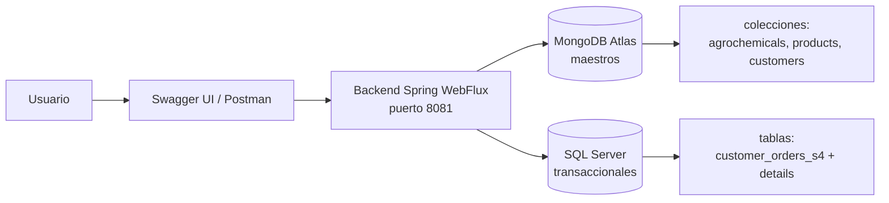

# AVSA Backend — API Reactiva Agroindustrial

Backend de **API REST reactiva** (Spring Boot + Spring WebFlux) del sistema agroindustrial **AVSA**. Expone catálogos maestros, pedidos de clientes, aplicaciones de agroquímicos y endpoints de analítica, conectándose de forma **simultánea y reactiva** a dos motores de base de datos.

## Módulos

- **Maestros (catálogos):** agroquímicos, productos y clientes.
- **Transaccionales:**
  - **Pedidos de clientes:** cabecera + detalle con cálculo de subtotal, IGV (18 %) y total, y control de stock.
  - **Aplicaciones de agroquímicos:** registro de aplicaciones en campo con dosis, condiciones climáticas y validación de productos.
- **Analítica:** pipelines de agregación para resumen por categoría y ranking por fabricante.

## Arquitectura de datos

El proyecto separa los datos en **dos motores**, según el tipo de información:

| Motor | Rol |
|---|---|
| **MongoDB** | Base de datos única de datos maestros, con las colecciones `agrochemicals`, `products` y `customers`. Documentos flexibles y desnormalizados. |
| **SQL Server** | Datos transaccionales (pedidos, aplicaciones). Integridad relacional con cabecera + detalle. |



**Flujo de una operación transaccional (`POST /v1/api/customer-orders`):**

1. El cliente envía el pedido (JSON) con `customerId` y lista de `productId` + `quantity`.
2. El backend valida el **cliente activo** en MongoDB (`customers`).
3. Resuelve cada línea contra el catálogo y **agrega las repetidas** del mismo producto, de modo que 2 + 3 del mismo artículo se descuentan como 5 y no se validan por separado.
4. Descuenta el stock con un `$inc` condicional por producto (`currentStock >= cantidad`), que MongoDB aplica de forma atómica sobre el documento.
5. Persiste la **cabecera** y el **detalle** en SQL Server usando R2DBC, dentro de la transacción.
6. Si la parte SQL Server falla, **revierte el descuento** ya aplicado antes de propagar el error.

### Alcance de las transacciones y consistencia

`@Transactional` cubre **únicamente SQL Server**: una transacción R2DBC no puede abarcar una escritura en MongoDB. Por eso el stock nunca se modifica con el patrón *leer → restar → guardar*, que bajo concurrencia pierde actualizaciones, sino con una operación atómica de un solo documento.

Cuando un flujo toca las dos bases, la consistencia se garantiza con **compensación explícita**, no con atomicidad distribuida:

| Paso | Si falla, se revierte |
|---|---|
| Descuento de stock (MongoDB) | Se reponen las unidades descontadas |
| Escritura en SQL Server | La transacción SQL hace rollback y el stock se repone |

Si la propia compensación falla, se registra el error en el log con el contexto del flujo, pero se conserva el error original que explica el fallo real.

Los lotes se aplican **en orden estable por identificador** para que dos operaciones concurrentes sobre los mismos productos no se bloqueen entre sí.

### Códigos de respuesta

Los errores de negocio se traducen en códigos HTTP con sentido mediante `GlobalExceptionHandler`:

| Situación | Código |
|---|---|
| Dato inválido en la petición (cantidad ≤ 0, estado desconocido) | `400` |
| Recurso inexistente | `404` |
| Regla de negocio incumplida (stock insuficiente, entidad inactiva, pedido ya cancelado) | `409` |
| Fallo inesperado | `500` |

Antes los endpoints envolvían sus errores con `onErrorResume` y devolvían `200` con un cuerpo `{"error": "..."}`, lo que hacía que un borrado fallido pareciera exitoso.

## Tecnologías

| Tecnología | Uso |
|---|---|
| Spring Boot 3.4.5 + Spring WebFlux | API reactiva no bloqueante (puerto `8081`) |
| Spring Data MongoDB Reactive | ODM para los maestros |
| Spring Data R2DBC | ORM reactivo para SQL Server |
| Java 25 | Lenguaje (configurado en `pom.xml`) |
| Maven | Build (wrapper `./mvnw` / `.\mvnw.cmd`) |
| Lombok | Reducción de código repetitivo |
| SpringDoc OpenAPI | Documentación interactiva (Swagger UI) |
| Spring Boot Actuator | Health checks (`/actuator/health`) |
| Docker / Kubernetes | Despliegue (Dockerfiles y manifiests por integrante) |

## Esquema de base de datos

### MongoDB (maestros)

La aplicación usa **una sola base de datos** (default: `db_avsa`) con sus **3 colecciones**. Al arrancar, `MongoDatabaseInitializer` verifica la existencia de las colecciones y las **crea automáticamente** si no existen; `DataSeeder` las puebla con datos de prueba la primera vez (agroquímicos, productos y clientes).

| Colección | Clase Java | Propósito |
|---|---|---|
| `agrochemicals` | `Agrochemical.java` | Catálogo de agroquímicos (`commercialName`, `activeIngredient`, `category`, `senasaRegistrationNumber`, `registrationExpiry`, `maxDose`, `manufacturer`, etc.) |
| `products` | `Producto.java` | Catálogo de productos (`code`, `name`, `category`, `unitMeasure`, `unitPrice`, `currentStock`, `minimumStock`, `origin`, `active`) |
| `customers` | `Customer.java` | Cliente maestro (`code`, `businessName`, `ruc`, `documentType`, `country`, `city`, `primaryContact`, `customerType`, `state`) |

### SQL Server (transaccionales)

Las 3 transaccionales cubren a los 3 maestros: **órdenes de clientes** (`customer`), **aplicaciones de agroquímicos** (`agrochemical`) y **movimientos de stock** (`product`). Nombres de columnas en inglés.

| Tabla | Clase Java | Propósito |
|---|---|---|
| `customer_orders_s4` | `CustomerOrder.java` | Cabecera del pedido (`orderNumber`, `customerId`, `orderDate`, `status`, `subtotal`, `igv`, `total`) |
| `customer_order_details_s4` | `CustomerOrderDetail.java` | Líneas del pedido (`productId`, `product_unit`, `quantity`, `unitPrice`, `subtotal`) |
| `agrochemical_applications` | `AgrochemicalApplication.java` | Cabecera de aplicación de agroquímicos en campo (`applicationNumber`, `fieldName`, `areaHectares`, `status`) |
| `agrochemical_application_details` | `AgrochemicalApplicationDetail.java` | Líneas de aplicación (`agrochemicalId`, `appliedDose`, `unitMeasure`, `totalCost`) |
| `product_stock_movements` | `ProductStockMovement.java` | Movimientos de inventario de productos (`movementNumber`, `movementType` IN/OUT, `quantity`, `totalValue`) |

Los DDL, consultas y datos están en los scripts raíz, numerados para ejecutarlos en orden (todo en inglés):

- `00-limpiar-y-reiniciar.sql` — borra las tablas y objetos previos para empezar de cero.
- `01-crear-estructura-completa.sql` — creación de las 5 tablas con restricciones (CHECK de estados `PENDING/CONFIRMED/IN_PROCESS/DELIVERED/CANCELLED` y `SCHEDULED/IN_PROCESS/COMPLETED/CANCELLED`, CHECK `IN/OUT`, `order_number`/`application_number`/`movement_number` únicos), índices y datos de ejemplo de las 3 transaccionales.
- `02-consultas-reportes.sql` — consultas de verificación y reportes (conteos, JOINs y resúmenes por estado/tipo).
- `03-vaciar-tablas-transaccionales.sql` — deja las 3 transaccionales vacías conservando la estructura.

> Las columnas reales de la cabecera de pedidos son `customer_name` e `igv`, y las del detalle `product_unit`. Las entidades Java las mapean a esos nombres con `@Column` para no cambiar los nombres que expone la API.

## Endpoints

| Módulo | Endpoints |
|---|---|
| Agroquímicos | `GET/POST /v1/api/agrochemicals`, `GET/PUT /v1/api/agrochemicals/{id}`, `PATCH /v1/api/agrochemicals/{id}/delete`, `PATCH /v1/api/agrochemicals/{id}/restore` |
| Clientes | `GET/POST /v1/api/customer`, `GET/PUT /v1/api/customer/{id}`, `GET /v1/api/customer/state/{state}`, `PATCH /v1/api/customer/delete/{id}`, `PATCH /v1/api/customer/restore/{id}` |
| Productos | `GET/POST /api/productos`, `GET /api/productos/estado/{estado}`, `GET/PUT /api/productos/{id}`, `PATCH /api/productos/{id}/eliminar`, `PATCH /api/productos/{id}/restaurar` |
| Pedidos | `POST/GET /v1/api/customer-orders`, `GET /v1/api/customer-orders/{id}`, `GET /v1/api/customer-orders/number/{orderNumber}`, `GET /v1/api/customer-orders/customer/{customerId}`, `PUT /v1/api/customer-orders/{id}`, `PUT /v1/api/customer-orders/{id}/status/{newStatus}`, `PUT /v1/api/customer-orders/{id}/cancel` |
| Aplicaciones de agroquímicos | `POST/GET /v1/api/agrochemical-applications`, `GET/PUT /v1/api/agrochemical-applications/{id}` |
| Movimientos de stock | `POST /v1/api/stock-movements/in`, `POST /v1/api/stock-movements/out`, `GET /v1/api/stock-movements`, `GET /v1/api/stock-movements/{id}`, `GET /v1/api/stock-movements/producto/{productId}`, `GET /v1/api/stock-movements/tipo/{movementType}` |
| Agregaciones | `GET /v1/api/aggregations/productos/por-categoria`, `GET /v1/api/aggregations/agroquimicos/por-fabricante` |
| Health | `GET /actuator/health` |

Ejemplo de creación de agroquímico:

```bash
curl -X POST http://localhost:8081/v1/api/agrochemicals \
  -H "Content-Type: application/json" \
  -d '{"commercialName":"Karate Zeon","activeIngredient":"Lambda-Cialotrina 5%","category":"INSECTICIDE","senasaRegistrationNumber":"SEN-2024-002","registrationExpiry":"2027-06-30","maxDose":1.5,"waitingPeriodDays":21,"manufacturer":"Syngenta"}'
```

## Puesta en marcha

### Requisitos

- JDK 21.
- Maven wrapper incluido (`.\mvnw.cmd` en Windows, `./mvnw` en Linux/macOS).
- Una instancia de **SQL Server** con la BD `avsa_db` (ejecutar antes `00-limpiar-y-reiniciar.sql` y luego `01-crear-estructura-completa.sql`).
- Un cluster **MongoDB Atlas** (o local) con las colecciones `agrochemicals`, `products` y `customers`.

### Variables de entorno

El backend lee (con `spring-dotenv`) estas variables. **Copie `.env.example` a `.env`** y reemplace con credenciales reales:

```dotenv
MONGODB_URI=mongodb+srv://<usuario>:<contraseña>@<cluster>.mongodb.net/<bd>?retryWrites=true&w=majority
R2DBC_URL=r2dbc:mssql://<host>:1433/avsa_db?trustServerCertificate=true
R2DBC_USERNAME=<usuario-sql>
R2DBC_PASSWORD=<contraseña-sql>
```

> `application.yaml` trae **valores por defecto** para desarrollo local. No use credenciales reales versionadas en entornos compartidos; expóngalas solo por variables de entorno o Secrets.

### Ejecutar

```bash
# Windows
.\mvnw.cmd clean compile
.\mvnw.cmd spring-boot:run

# Linux/macOS
./mvnw clean compile
./mvnw spring-boot:run
```

Swagger UI: <http://localhost:8081/swagger-ui.html>

### Datos de prueba

- `agrochemicals-test-data.json` / `productos-test-data.json` — datos semilla de maestros.
- `test-aplicacion-agroquimico.json` — ejemplo de cuerpo para aplicar un agroquímico.
- `demo-pedido-exitoso.json` / `demo-pedido-fallido.json` — ejemplos de cuerpo para probar el alta de un pedido y el error por stock insuficiente.
- `01-crear-estructura-completa.sql` — incluye datos de ejemplo de las 3 transaccionales (órdenes, aplicaciones y movimientos de stock).
- Colecciones Postman: `Agrochemicals-WebFlux-API.postman_collection.json`, `Productos-WebFlux-API.postman_collection.json`.

## Estructura del proyecto

```
src/main/java/pe/edu/vallegrande/app/
├── config/        # TransactionConfig (límite transaccional), DataSeeder, MongoDatabaseInitializer
├── dto/           # DTOs de entrada/salida
├── model/         # Entidades MongoDB y SQL Server
├── repository/
│   ├── mongo/     # Repositorios reactivos MongoDB (maestros)
│   └── r2dbc/     # Repositorios reactivos R2DBC (transaccionales)
├── rest/          # REST controllers de cada módulo + GlobalExceptionHandler
├── service/       # Lógica de negocio reactiva (Mono/Flux) + ProductoStockService
└── resources/
    ├── application.yaml
    └── mongodb/   # pipelines de agregación e índices
```

### Archivos clave de consistencia

| Archivo | Responsabilidad |
|---|---|
| `config/TransactionConfig.java` | Fija el `R2dbcTransactionManager` como gestor transaccional y documenta que la transacción no abarca MongoDB. |
| `service/ProductoStockService.java` | Ajustes de stock con `$inc` condicional y compensación por lote. Único punto que escribe `currentStock`. |
| `rest/GlobalExceptionHandler.java` | Traduce excepciones a códigos HTTP; evita el patrón de devolver `200` con error embebido. |

## Despliegue

- **Docker:** imagen `alexandraquispe/avsa-backend:1.0`, construida con
  `dockerfile-alexandraquispe/Dockerfile` desde la raiz del repositorio. El smoke test
  con Java 25 y MongoDB efimero respondio `200` en `/actuator/health/liveness`.
- **EC2:** script `deploy-ec2.sh` descarga la imagen publica y corre el contenedor.
- **Kubernetes:** manifiestos centralizados en `manifest-alexandraquispe/` para los
  tres componentes (backend, analitico y frontend). Guia completa en
  `manifest-alexandraquispe/README-COMANDOS.md`.

## Seguridad

- Las credenciales reales (`MONGODB_URI`, `R2DBC_PASSWORD`, usuarios) **no deben subirse al repositorio**; van en `.env` (ignorado por `.gitignore`) o en Secrets de Kubernetes.
- Antes de publicar capturas o documentación, difuminar contraseñas y datos sensibles.